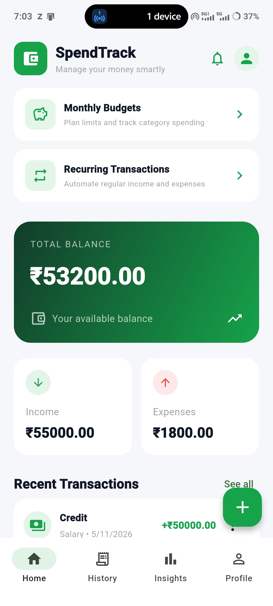
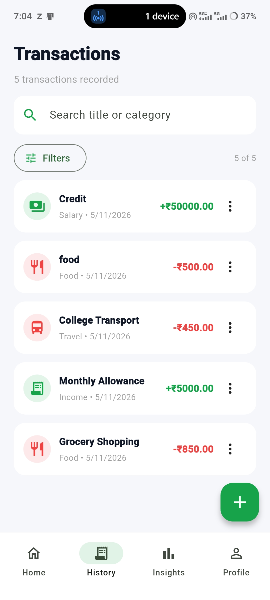
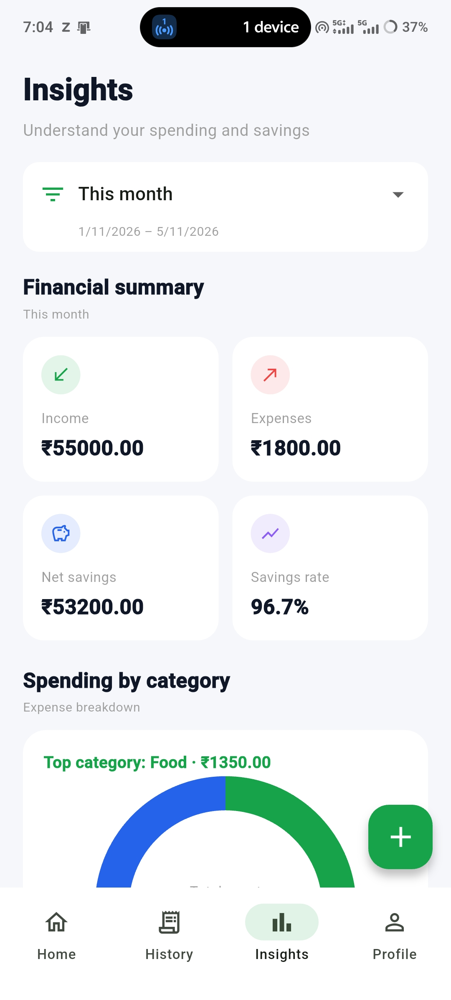
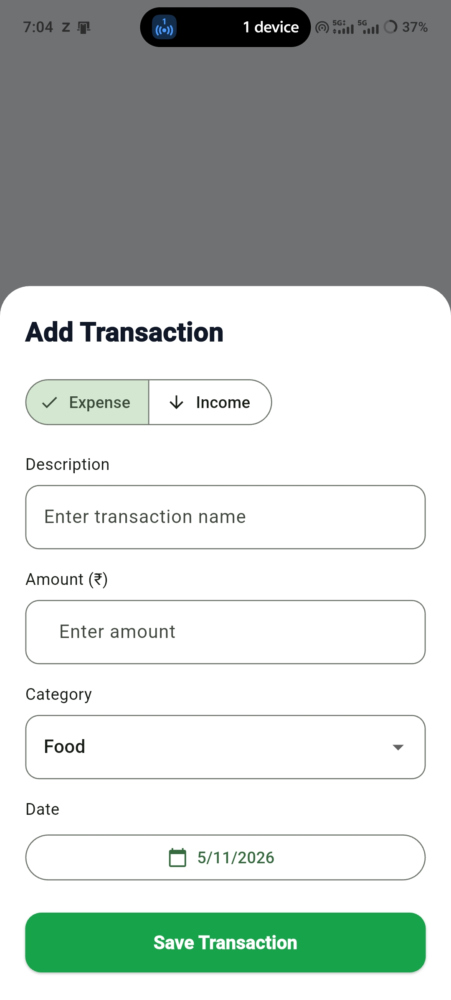

# SpendTrack

SpendTrack is a local-first Flutter expense tracker for recording transactions,
monitoring budgets, and understanding personal spending. Transaction, budget,
recurring schedule, and in-app notification data are stored on the device using
`shared_preferences`; no backend or cloud account is required.

## Features

- Home dashboard with balance, income, expenses, and recent transactions.
- Transaction creation, editing, deletion, search, filtering, and sorting.
- Advanced insights, date filters, spending trends, and category breakdowns.
- Monthly and category-specific budgets with spending progress and alerts.
- Recurring income and expense schedules with pause/resume controls.
- In-app notifications with read/unread state and local persistence.
- Home, History, Insights, and Profile navigation tabs.
- Responsive layouts and empty states.

## Technologies

- Flutter and Dart
- Material Design
- `shared_preferences` for on-device persistence
- Flutter widget and unit tests

## Requirements

- Flutter SDK matching the Dart constraint in `pubspec.yaml`
- Android Studio or Android SDK for Android builds
- An emulator or physical device for running the application

## Installation

Clone or download the project, open a terminal in the project directory, and
install dependencies:

```shell
flutter pub get
```

## Run the application

Start an emulator or connect a device, then run:

```shell
flutter run
```

Useful project checks:

```shell
flutter analyze
flutter test
flutter build apk --release
```

## Screenshots

Screenshots are not included yet. Add captured application images under a
`screenshots/` directory and link them here when available.

## Release signing

The Android release build currently uses the default debug signing
configuration. The generated APK is suitable for local testing only, not for
publishing or distribution as a production release. Configure a private
release keystore and reference it through ignored local signing configuration
before publishing. Never commit keystore files, passwords, or signing secrets.


## Testing and Validation

SpendTrack undergoes testing to verify its functionality, reliability, and application stability.

### Code Quality

Flutter analyzer is used to identify potential coding issues and maintain code quality.

```bash
flutter analyze
```

### Application Testing

Flutter tests are executed to verify application components and expected behavior.

```bash
flutter test
```

The project test suite successfully completed 45 tests during release validation.

### Functional Validation

The following areas were checked:

- Transaction creation, editing, and deletion.
- Income and expense tracking.
- Monthly budget management.
- Recurring transaction functionality.
- Local data persistence after application restart.
- Navigation between application screens.

### Data Security

- Transaction and budget information is stored locally on the device.
- Signing keystores and passwords must never be uploaded to GitHub.
- Local signing configuration is excluded from version control.
- Users should maintain backups of important application data.

### Project Maintenance

Regularly run Flutter analysis and tests before making changes or preparing a new release to maintain application stability and code quality.

## Testing and Quality Assurance

Testing is an important part of SpendTrack development to ensure that financial records, budget calculations, and application features work correctly.

### 1. Functional Testing

The following application features are checked:

- Transaction management: Verify adding, editing, deleting, searching, and filtering transactions.
- Dashboard calculations: Check available balance, total income, and total expenses.
- Budget management: Verify budget creation, spending limits, and progress calculations.
- Recurring transactions: Check schedule creation, pause, and resume functionality.
- Notifications: Verify notification status and updates.
- Navigation: Check movement between Home, History, Insights, and Profile.

### 2. Important Test Cases

| Test Scenario | Expected Result |
|---|---|
| Add income | Income record is saved |
| Add expense | Expense record is saved |
| Edit transaction | Updated details are displayed |
| Delete transaction | Selected record is removed |
| Apply transaction filter | Matching records are displayed |
| Create budget | Budget is saved successfully |
| Exceed budget limit | Spending alert is triggered when applicable |
| Restart application | Locally saved data is retained |
| Mark notification as read | Notification status changes |

### 3. Automated Testing

Flutter provides testing tools to validate application quality.

```bash
flutter analyze
flutter test
```

- `flutter analyze` identifies potential code issues.
- `flutter test` executes the available automated test cases.

### 4. Data Reliability and Security

- Verify that transaction information is stored locally.
- Check data persistence after application restarts.
- Validate financial calculations and transaction updates.
- Ensure invalid or incomplete inputs are handled appropriately.
- Avoid exposing passwords, signing keys, or sensitive credentials in the repository.

### 5. Testing Summary

The application has been manually tested on a physical Android device. Core functionality and navigation have been verified. Automated tests can additionally be executed to identify potential issues and maintain code quality.


## Screenshots

### Home Dashboard


### Transaction History


### Insights


### Add Transaction

